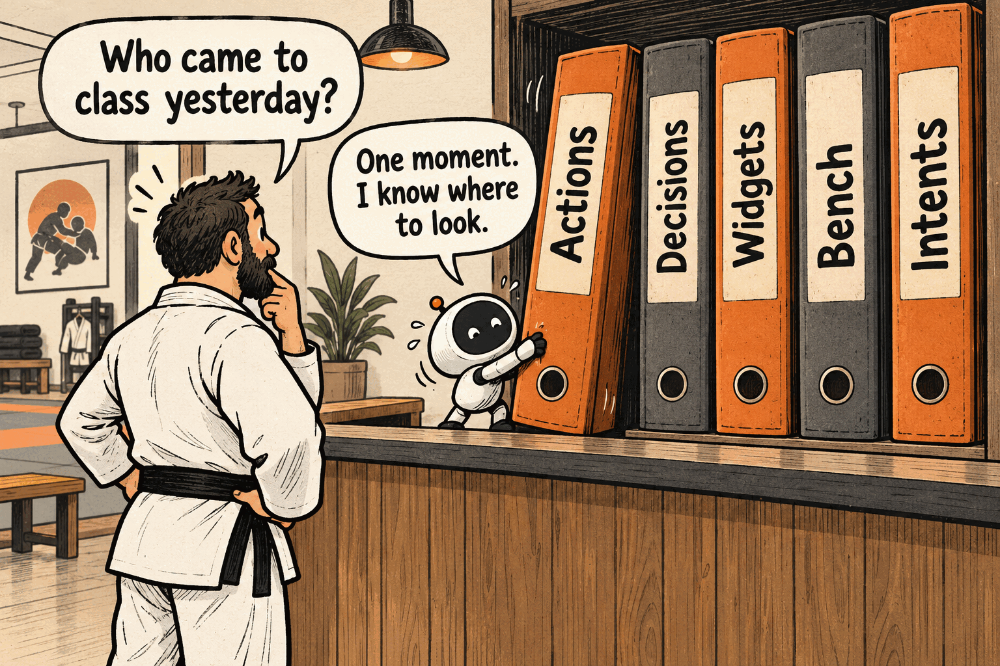
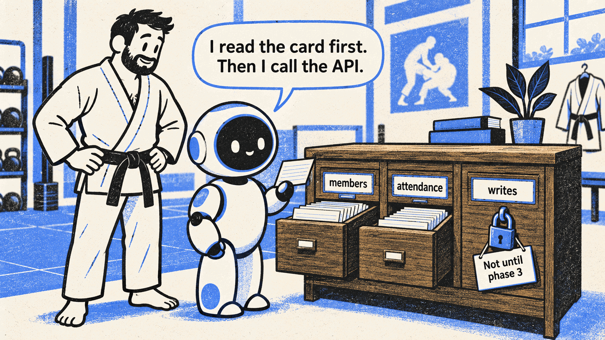
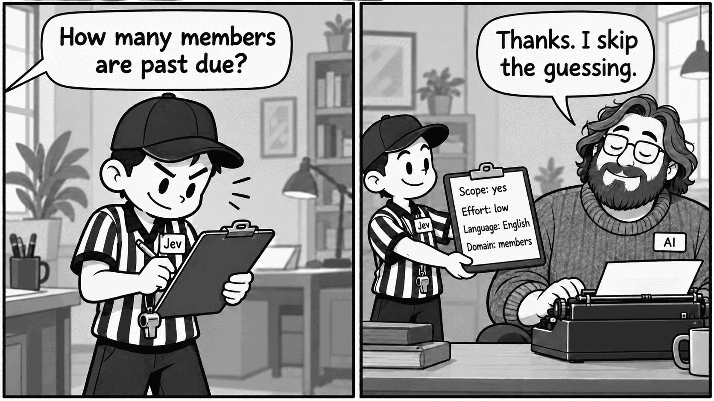
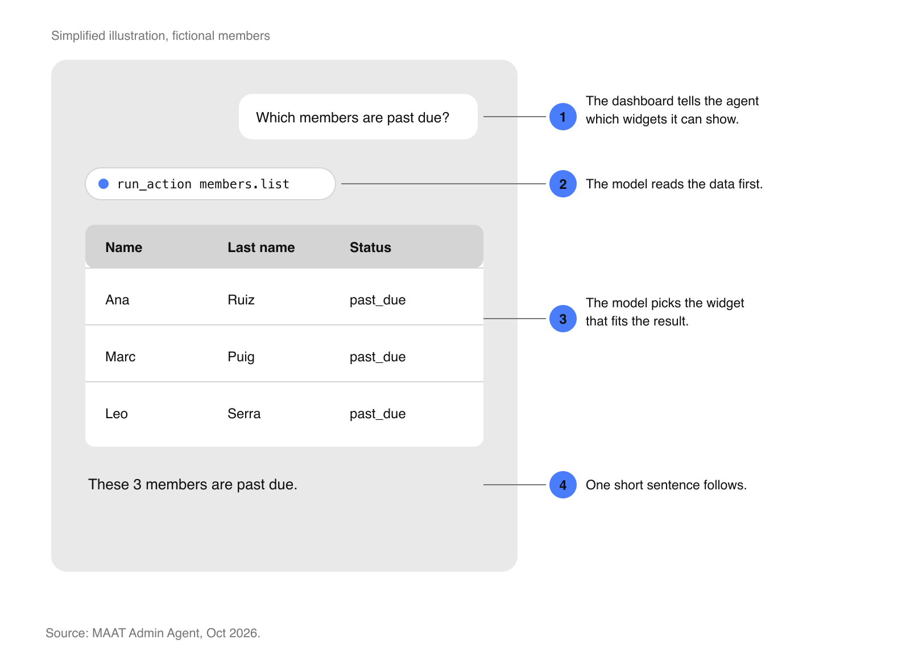
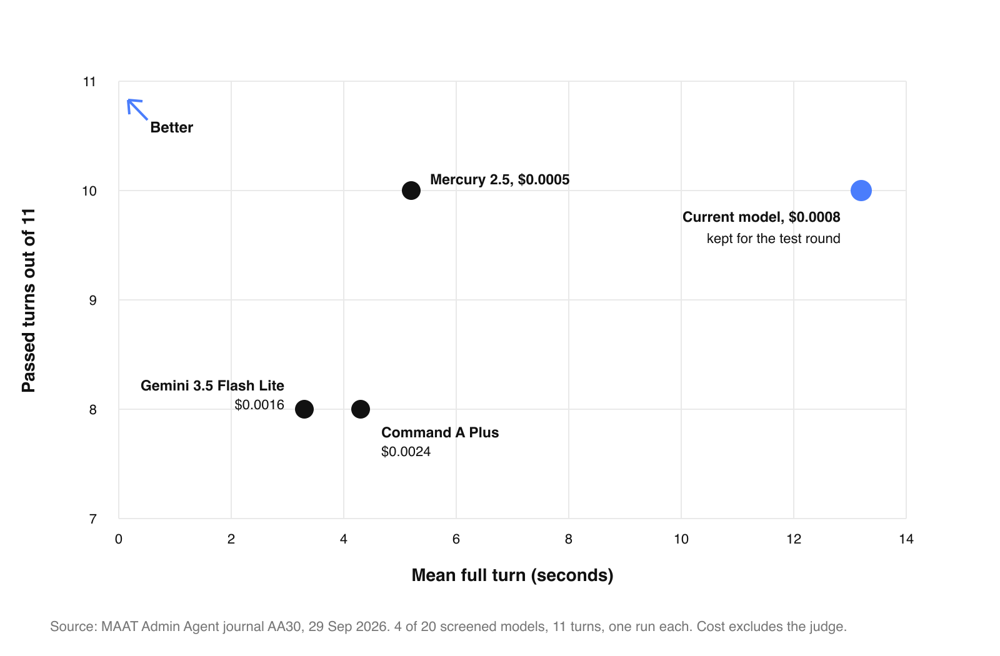
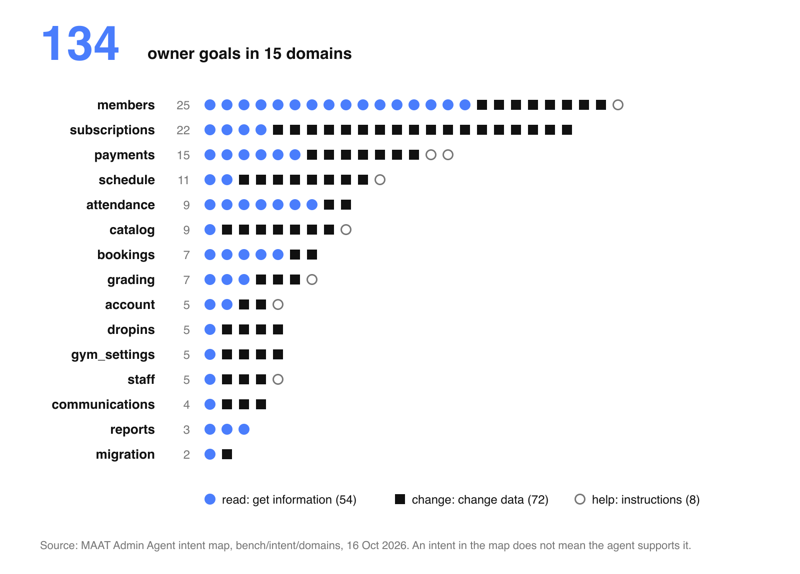

MAAT makes software for combat sports gyms. Since September 2026 we build the MAAT Admin Agent: a chat inside the MAAT Admin Dashboard where a gym owner asks questions about the gym in plain language. Examples: "How many members are past due?" and "Which classes were the most popular this year?" Without the agent, an owner finds these answers by hand, one dashboard screen after another.

I drive the Admin Agent project at MAAT, and I own its AI infrastructure and backend work. This article shows how we built the agent, part by part:

1. How the agent gets data from the MAAT backend API through MCP-style actions.
2. How a small Decision model, Jev, prepares each turn before the AI model writes the answer.
3. How the agent shows widgets, such as tables and charts, inside its answers.
4. How we test the agent with a bench of fixed cases.
5. How we find what owners ask for in real conversations that the agent has.

The agent is read only. Today we test it on a seeded gym and with internal users. A closed beta with customer gyms comes next.

## Using MCP-style actions to access the MAAT backend API

The agent never reads the database. It calls the same backend API that the MAAT Admin Dashboard uses, with the owner's own session. The backend stays the only authority on data and access, so the agent needs no separate access rules.

The agent reads an action card before it calls the API. The write drawer stays locked until a later phase.

### One action for each read route of the backend API

The agent has a catalog of actions, in the style of an MCP server. Each action reads one route of the backend API, and it has a short description that tells the model what it returns. The model first finds the right domain, such as members or attendance. Then it picks an action and calls it.

Today the catalog has only read actions. The agent can answer questions, but it cannot change data. Write actions come in a later phase, with owner approval for each change.

## How we use Jev as a Decision model before the AI model writes the answer

Each owner turn has two kinds of model calls. A small, fast model decides. A larger model writes.

Jev reads the question first and fills in the plan. The AI model writes the answer from that plan.

### The difference between the Decision call and the Generation call

The **Decision call** is one small, fast request at the start of each turn. Today the Decision model is Jev. Jev does not write text. It returns a probability for each question that we ask about the owner's message.

The **Generation call** writes the answer and calls the tools. A larger AI model does this work.

Code turns Jev's probabilities into a plan for the turn. The Generation call reads only that plan.

### The four questions that Jev answers for each message

| Question | What it changes |
| --- | --- |
| Is this message about the gym? | The agent answers, or declines politely. |
| Does it need careful thinking? | The AI model uses low or high reasoning effort. |
| Which language is it in? | The AI model answers in the owner's language. |
| Which domain holds the data? | The AI model gets the actions of that domain directly. |

If Jev does not answer in time, the plan uses safe defaults, and the AI model decides by itself.

### Why a separate Decision model reduces steps and cost

We could ask the AI model to make these decisions itself. But each decision then costs a full model step, and the model can forget a rule in a long prompt. Jev answers narrow questions fast, and code applies the result. The decisions are numbers that we can trace, test and change.

The domain question shows the gain. Before we made it the default, we compared it on the bench with 70 test turns:

| Measure | Without domain choice | With domain choice |
| --- | --- | --- |
| Model steps | 213 | 121 |
| Input tokens | 609k | 485k |
| Cost | $0.047 | $0.029 |

Model steps fell by 43%, input tokens fell by 20%, and cost fell by 39%.

## How widgets appear in the chat

Some answers are better as a table or a chart than as text. We call these components widgets. The MAAT dashboard has tables, value tiles, member cards, email drafts and charts.

The widget comes first, then at most one short sentence. Simplified illustration with fictional members.

### How the AI model picks a widget

The dashboard tells the agent which widgets it can show. The AI model first gets the data. Then it picks the widget that fits the result, for example a table for a list of members or a chart for attendance over time. The widget shows only data that the agent read in this turn. A short sentence follows it.

The dashboard owns the widgets, so MAAT can add a new widget without a change to the agent.

## How we benchmark the agent

A prompt change can fix one answer and break another. A bench of fixed questions with known answers, on a test gym, tells us if a change is safe before it reaches owners.

Four models from a 20-model screening. One run per case, so this is a screening, not a calibrated accuracy measure.

### Comparing 20 models on accuracy, speed, and cost

The model is one line of configuration, so the bench can compare models. We screened 20 candidates, then ran the best ones on a larger set of questions. We compared how many answers were correct, how long a turn took, and what a turn cost.

We kept our current model for the internal test round. It was accurate, already live, and cost about $0.0009 per turn. The launch model is still an open decision.

## How we capture owner intent from real conversations

The bench tests the questions that we expect. Intent analysis shows the questions that owners actually ask. It reads real conversations that the agent has, and it tells us which owner goals the agent answers well, which it answers badly, and which it cannot answer yet.

The intent map lists the goals that an owner can have. An intent in the map does not mean that the agent can do it.

### From conversations to owner goals

One conversation can contain several requests. An AI step splits each conversation into separate owner goals. Then Jev matches each goal to our intent map: 134 owner goals in 15 product domains, such as members, payments and schedule. When a match is not clear, a person reviews it.

More than half of the goals, 72 of 134, change data. The agent is read only today, so these goals show the size of the work for the write phase.

### Using unmet requests to plan the next actions

A local tool, Intent Explorer, shows the goals that the agent answered only in part, or not at all. These unmet requests tell us which actions and widgets to build next.

## What we learned while building the agent

These points apply to any agent that answers questions from business data:

1. **Write the questions before the prompts.** This is test-driven development for agents. A question with a known answer is the test. The prompt and the actions are the code that must pass it.
2. **Observability is your best friend, and it needs real focus.** Every turn of our agent sends a trace with the plan, the tool calls, the time and the cost. Without traces, you cannot see why an answer is wrong. Without traces, there is no intent analysis either.
3. **Separate the Decision model from the Generation model.** Test what a small, fast model can decide well, and give those decisions to it. The large model then does less work, and each decision is a number that you can measure.
4. **Treat non-deterministic code as non-deterministic.** A model call can give a different answer for the same input. Mark every function that calls a model, so that people and coding agents know it. In our code, each Decision file starts with a note: Jev is an AI, its answers are probabilities, and a decided value is a choice, not a fact.
