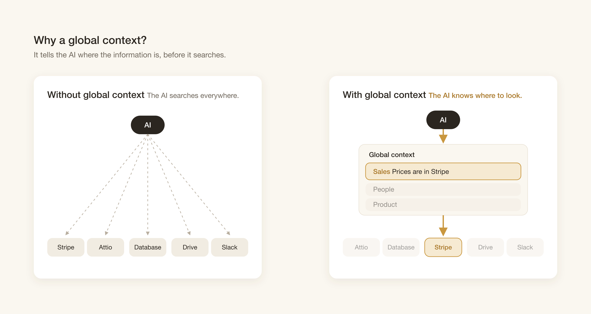
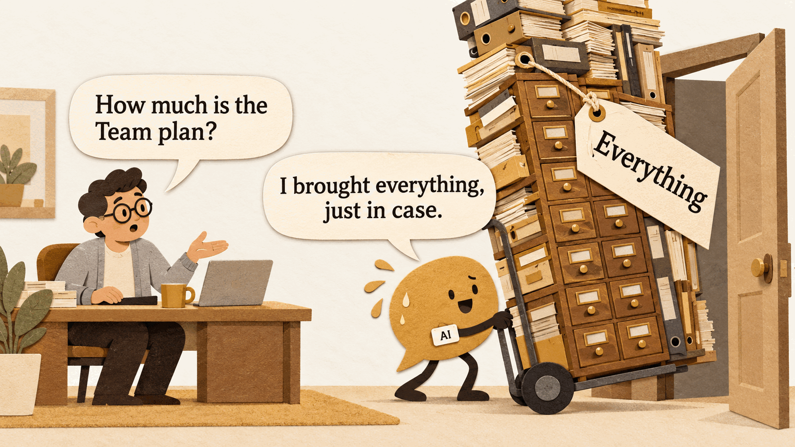
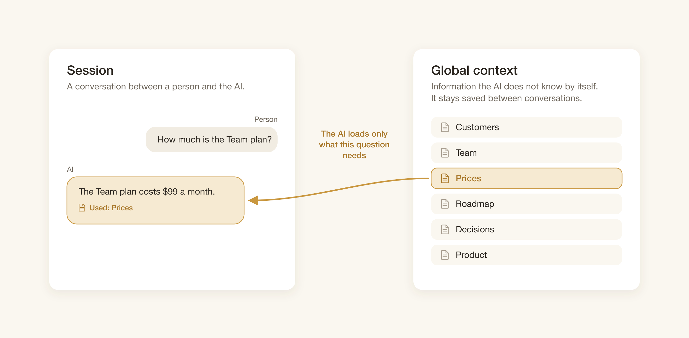
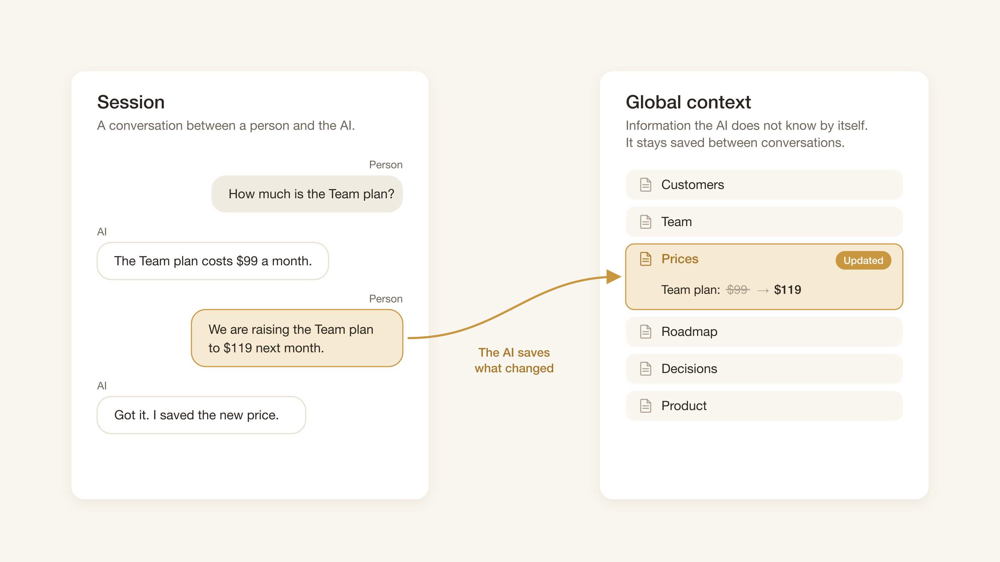
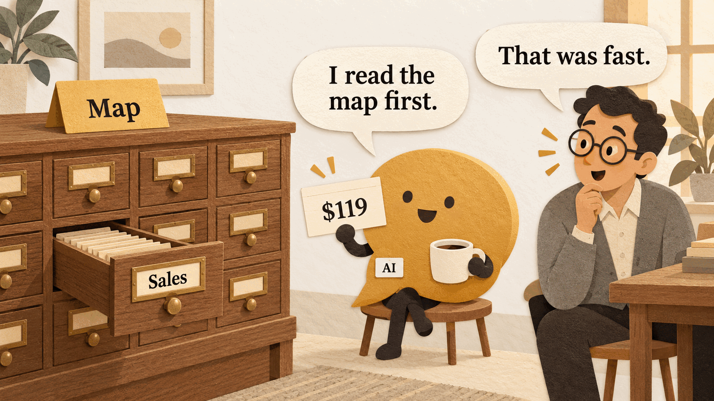

What does your agent do when someone asks it for a price?

Here is a fictional example. On Tuesday, the founder tells the agent: "The Team plan goes up to $119 next month." The agent answers: "Got it." On Friday, a colleague opens a new session and asks the agent to write a renewal email. The agent can use Stripe, Attio, a database, Drive, and Slack. It does not know which one has the price, so it searches all five. In Slack, it finds a message from March: "Team plan: $99." The email says $99.


A fictional example. On Friday, the agent searches every drawer and finds an old price.

The model did not fail at reasoning. Two other things failed:

1. On Friday, nothing told the agent where the price was. So it searched everywhere and took the first number it found.
2. On Tuesday, nobody saved the new price. The decision stayed in a conversation that ended.

This article is about the information that fixes both failures. I call it the global context. I explain what it is, how the agent loads it, how it saves to it, and how to write it. All examples (prices, team, tools, and dates) are fictional and simplified.

## The model knows the world, not your business

An AI model learns from a very large amount of public text. It can explain what a subscription is, or how to write a polite email. It cannot know your prices, your team, or what you decided on Tuesday. That information is not public, and much of it did not exist when the model was trained.

So for each task, the agent must get some information from outside the model. The global context is that information: what the model does not know by itself and needs to get for a specific task. It stays saved between conversations.

One conversation between a person and the AI is a session. The Tuesday talk with the founder was one session. The Friday email request was another. The sessions do not share memory. The global context is what connects them.

## Failure one: nothing told the agent where to look

On Friday, the agent had access to five tools. Access is not the same as knowing where to look. The agent had to open each tool, read the results, and decide which number was the price. The old Slack message looked as good as any other result.


Access to every drawer does not tell the agent which drawer has the price.

### A map split into domains tells the agent where to look

The fix for this failure is a map. The global context is split into domains. A domain is one area of the information with its own purpose, for example Sales, People, or Product. The map lists the domains, and each domain gets one line that says what it holds.

Here is a fictional global context for the company in the story. It is a folder of text files, but the shape is what matters, not the format.

```text
global-context/            (fictional example)
  map.md
  sales/
    prices.md              plans, prices, discounts, price changes
    customers.md           accounts and renewal dates
  people/
    team.md                who does what, who decides what
  product/
    roadmap.md             what ships next, and when
```

And this is the map:

```text
Map (fictional example)

sales/    Prices, discounts, plan changes, customers.
          The price list is in prices.md. The source of record is Stripe.
people/   Team, roles, who decides what.
product/  Roadmap, release dates.

Rules
- Read this map before you search any tool.
- Load one domain at a time. Load only the domain the question needs.
- Save a change in the domain where it belongs.
```

With this map, the Friday session goes differently. The agent reads the map. The Sales line says where the price is. The agent goes to Sales, and only to Sales. It does not open Slack.



Without a map, the AI searches everywhere. With a map, it reads one line and goes to one place.

## The session loads only the domain the question needs

A map solves one problem and opens another one. If the agent now knows where everything is, why not load all of it at the start of each session? Then it never has to search.

I think this is the wrong move. The session context is all the information that the AI has during one session. My goal is that it is as small and exact as possible. The People and Product domains do not help with a price question. In the session, they are text that the model must read, and text that it can confuse with the answer. The old Slack message was exactly that kind of text.



Loading all the information does not make the answer better. It makes the session larger.

So at the start of a session, the agent gets only two things: the map, and the rules to find information in it. In the fictional example, that is the map file above and nothing else. When the colleague asks about the Team plan, the agent loads the Sales prices and no other domain. The rest stays in the global context, saved but not loaded.



For a price question, the AI loads Prices and nothing else. Customers, Team, Roadmap, and the other files stay out of the session.

## Failure two: the Tuesday decision was never saved

With a map and a small session, the Friday agent finds the price list fast. But it still finds $99. The map fixed where the agent looks. It did not fix what it finds there. The second failure happened on Tuesday, not on Friday.

A session does not only read information. It also creates it. The founder explained a decision. A colleague can correct a fact, or change a date. If the agent does not save that change, the change is lost when the session ends. The next session starts from the old information, and someone has to explain the change again.


The Tuesday session, without a save step. The decision is wiped with the session.

The fix for this failure is a save step. When the founder says that the Team plan goes up to $119, the agent saves that change in the Sales domain, in the price list. The map rule says where: "Save a change in the domain where it belongs." On Friday, the new session reads the map, loads Sales, and finds $119. Nobody has to repeat the Tuesday conversation.



The Tuesday session, with a save step. The price list in the global context now has the new price.

The two fixes depend on each other. The save step only helps if the next session can find what was saved. The map only helps if what it points to is current.

## Write the global context for how the AI loads it

The map, the small session, and the save step all put the same demand on the information itself. The agent reads the map alone. It loads one domain alone. So the information must work when it is read that way. This is my main rule:

> Write the global context for how the AI loads it. Minimal to load, fast to find.

A global context is not a place for all company documents. Its structure must fit the two moments when the agent touches it: when it reads the map, and when it loads one domain. Two examples of the rule follow.

### Each domain must make sense alone

The agent loads one domain at a time. So each domain must answer its questions without the other domains, and without a person. In the fictional example, a price list that says "see the table from the meeting" is useless. The agent cannot see the meeting. "Ask Sales for the new price" is worse. The agent cannot ask.


A fictional example. The right card answers the renewal email question with no other file and no person.

The right card is what the Tuesday save step should produce: the old price, the new price, when it applies, and who decided it. That is the whole Friday answer in one domain.

### The names on the map must say what is inside

The agent reads the map first and chooses a domain from it. So the names on the map must tell the agent what is inside. "Sales: prices, discounts, plan changes" lets the agent choose. "Misc", "Stuff", and "final_v2_REAL" do not. A map with bad names sends the agent back to the drawers in the first comic, one by one.

## The adapter is the least important part

So far the article did not say how the agent reads a file or writes to it. That is on purpose. The whole system has three parts:

- The session: the conversation, with a small session context.
- The adapter: the tool that the AI uses to read and save. An MCP server, a folder of files, a database, anything.
- The global context: the information that the AI does not know by itself. It stays saved between conversations.

The adapter matters least. In the fictional example it is a folder of text files. It can also be an MCP server. You can change the adapter later, and the map and the domains stay the same. If the information is badly written, a better adapter does not fix it.


The three parts together. The load arrow brings one domain into the session. The save arrow sends a change back.

This table puts the Friday story next to its fixed version.

| | Without a global context | With a global context |
| --- | --- | --- |
| Where the agent looks | Every connected tool | The domain that the map names |
| What the session loads | All the search results | The map, the rules, and one domain |
| What Friday knows about Tuesday | Nothing | The saved price change |

## Try it on your own agent

You can make a first global context for your own agent with these steps:

1. List the ten questions that your agent gets most often.
2. For each question, write down where the answer is.
3. Group the answers into three to five domains.
4. Give each domain one line that says what it holds.
5. Load that list at the start of each session, together with one rule: "Read the map before you search."

Then test it. Ask the agent three usual questions before and after the change. Count the tool calls before it reaches the correct source. If the count does not go down, read your domain names again. Check that each name says what is inside. Then add the second rule, "Save a change in the domain where it belongs", and tell the agent one fictional change. Open a new session and ask for it.



The same Friday question, with a map and the Tuesday change saved. One drawer open, and the right price.
